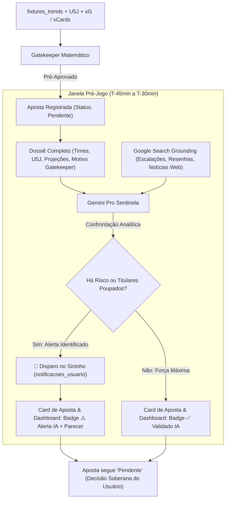

# Plano de Implementação: Arquitetura Híbrida Gatekeeper + Gemini Pro Sentinela

> **Data de Criação**: 25/10/2026  
> **Status**: Proposto para Validação  
> **Objetivo**: Resolver de forma estrutural o esgotamento precoce da cota da API-Sports (antes das 16h) e eliminar a "cegueira" do algoritmo pré-jogo em relação a escalações, reservas e contexto de clássicos (ex: River Plate x Racing), utilizando o **Gemini Pro** como auditor contextual inteligente sem custo de chamadas extras na API-Sports.

---

## 1. Visão Executiva e Diagnóstico

### 1.1 O Gargalo Atual
1. **Esgotamento da Cota da API-Sports**: O pipeline consome grande volume de requisições diárias antes das 16:00 BRT principalmente devido ao recálculo repetido de médias de times que já possuem histórico consolidado ou que não entraram em campo recentemente, além de varreduras gerais em horários de baixa atividade.
   * *Nota Arquitetural*: A esteira de fixtures (`football_ingest_trends.py`) já opera em janela estritamente curta (**D-1, D+0 e D+1**). A DAG de placares e tempo ao vivo a cada 3 minutos (`football_trends_live_dag`) consome exclusivamente a API pública da **Betano** com **custo zero** de API-Sports, sendo mantida integralmente pela relevância direta aos usuários do site.
   * *Preservação de Histórico*: A varredura em cascata de temporadas (`season`, `season - 1`, `season - 2`) em `football_ingest_teams_performance.py` é indispensável para início de competições e fases preliminares (ex: Champions League), garantindo amostragem mínima sem violar a Regra 9 (sem fallbacks artificiais).
2. **Cegueira Pré-Jogo do Modelo Estático**: O modelo atual (Poisson + Gatekeeper matemático) analisa apenas números históricos consolidados (médias e U5J). Em clássicos, decisões de copa ou partidas em que um favorito poupa 4 titulares, o algoritmo é incapaz de enxergar a rotação de elenco e aprova apostas com risco desproporcional.

### 1.2 A Solução: Arquitetura Híbrida Consultiva (Quant + Sentinela IA)
* **Preservação de Integridade Contábil**: O campo `status` da tabela `apostas` **permanece rigorosamente `'Pendente'`** (sem criar status novos que quebrem métricas de ROI, banca ou filtros de telas).
* **Sem Cancelamento Automático**: A Sentinela não cancela apostas de forma arbitrária; ela atua como **consultora de inteligência pré-jogo**. O usuário e apostador mantém a soberania da decisão.
* **Dossiê Analítico Rico**: A IA não faz apenas checagem cega de nomes. Ela ingere o panorama completo pré-jogo (U5J de ambos os times, médias esperadas de gols/cartões e o motivo técnico do Gatekeeper) antes de buscar a realidade factual do campo.
* **Pesquisa Ativa de Notícias e Escalações (Google Search Grounding)**: Busca em tempo real resenhas esportivas, escalações oficiais publicadas a 45-30 minutos e notícias de vestiário (titulares poupados, clima de clássico).
* **Entrega Imediata da Inteligência**:
  * Se houver risco/inconsistência factual: disparo imediato de alerta no **Sininho do sistema** (`notificacoes_usuario` + Toast pop-up) e exibição do parecer explicativo nas palavras da IA no **Card de Simulação de Apostas** e no **Card do Dashboard**.
  * Se a força máxima for confirmada: selo visual verde de conformidade nos cards.



---

## 2. Fases de Implementação

---

### Fase 1: Estancamento de Cota Redundante na API-Sports (Otimização Focada)

* **Meta**: Reduzir o consumo desnecessário de requisições, eliminando reprocessamento de times sem jogos recentes e garantindo cota disponível para o horário nobre.
* **Ações Técnicas**:
  1. **Script de Performance de Times (`scripts/football_ingest_teams_performance.py`)**:
     * Adicionar trava estrita de banco: se o time já possui médias calculadas com 5+ jogos e a data do seu último jogo finalizado (`last_match_date`) for anterior ao último cálculo registrado no banco, **não chamar a API-Sports** (reutiliza cache).
     * Manter intacta a busca em cascata de temporadas anteriores para equipes com amostragem insuficiente (< 3 jogos), preservando a integridade estatística em inícios de campeonato.
     * Reagendar a DAG `football_teams_performance_dag` das 03:00 para as **07:30 da manhã** (momento ideal após o fechamento de súmulas das rodadas noturnas).
  2. **Preservação Integral da Experiência do Usuário (Live In-Play)**:
     * Manter inalterada a DAG `football_trends_live_dag` a cada 3 minutos, pois ela roda via API da Betano com consumo zero de API-Sports.
  3. **Ingestão Principal de Fixtures (`scripts/football_ingest_trends.py`)**:
     * Pausar varreduras completas no intervalo da madrugada (02:30 às 07:00), executando apenas transições pontuais para `FT`.
  4. **Economia Estimada**: ~2.500 a 3.000 requisições diárias poupadas sem comprometer nenhuma funcionalidade de tela ou precisão estatística.

---

### Fase 2: Banco de Dados e Auditoria Semântica (Sem Novos Status)

* **Meta**: Armazenar os pareceres e alertas da Sentinela sem alterar o campo `status` da aposta (`'Pendente'`).
* **Estrutura de Dados**:
  1. **Tabela `apostas`**:
     * `auditoria_ia_status`: VARCHAR(30) NULL (`PENDENTE`, `CONFIRMADO`, `ALERTA_RISCO`).
     * `auditoria_ia_parecer`: TEXT NULL (explicação textual detalhada gerada pelo Gemini).
     * `auditoria_ia_resumo`: VARCHAR(255) NULL (resumo em 1 frase para o badge do card).
     * `auditoria_ia_checked_at`: DATETIME NULL.
  2. **Tabela `fixtures_trends`**:
     * Espelhar as colunas `auditoria_ia_status`, `auditoria_ia_resumo` e `auditoria_ia_parecer` para viabilizar a exibição direta nos cards do dashboard principal.
  3. **Tabela `notificacoes_usuario` (Sininho)**:
     * Reutilizar a infraestrutura existente de notificações (`tipo = 'ALERTA_SENTINELA_IA'`) para disparar pop-up Toast imediato na interface web.

---

### Fase 3: Arquitetura de Conexão e Troca de Dados (`scripts/gemini_sentinel.py`)

* **Meta**: Módulo Python de alta performance que extrai o dossiê da partida, conecta à API do Gemini Pro com Google Search Grounding ativo e persiste os resultados de volta ao ecossistema FootballWeb.

#### 3.1 Autenticação e Protocolo de Conexão
* **Segurança e Variáveis de Ambiente (Regra 18)**:
  * A credencial `GEMINI_API_KEY` é carregada exclusivamente a partir do arquivo canônico `src/footballweb/.env` ou do ambiente do sistema operacional (`os.environ`).
* **Endpoint REST Oficial**:
  * Utiliza chamada HTTP direta via biblioteca `requests` para o endpoint v1beta:
    `POST https://generativelanguage.googleapis.com/v1beta/models/gemini-1.5-pro:generateContent?key={GEMINI_API_KEY}`
  * **Vantagens**: Dispensa dependências externas pesadas no container do Airflow, com controle de timeout restrito (12 segundos) e tratamento nativo de falhas de rede.

#### 3.2 Ativação do Google Search Grounding
* O payload enviado ao Gemini inclui a ferramenta nativa de pesquisa web (`tools: [{"google_search": {}}]`):
  ```json
  {
    "contents": [{ "role": "user", "parts": [{ "text": "{PROMPT_DOSSIE}" }] }],
    "tools": [{ "google_search": {} }],
    "generationConfig": {
      "temperature": 0.2,
      "response_mime_type": "application/json"
    }
  }
  ```
* Durante a inferência, o próprio Gemini formula queries no Google (ex: *"escalação River Plate hoje titulares desfalques"*), lê portais esportivos (GloboEsporte, Olé, ESPN, Marca) e consolida a resposta com lastro factual recente.

#### 3.3 Ciclo de Dados de Ida e Volta (Airflow $\leftrightarrow$ MySQL $\leftrightarrow$ PHP)
1. **Extração do Dossiê**: O script conecta no MySQL via `db_config.py` e extrai os confrontos na janela T-45min a T-15min.
2. **Componentes do Dossiê**:
   * **Dados do Confronto**: Mandante, Visitante, Competição, Data/Hora e Árbitro;
   * **Histórico U5J**: Forma recente, pontos, gols marcados e sofridos de cada time;
   * **Projeções do Modelo**: Expectativa de gols (xG mandante/visitante) e cartões esperados;
   * **Tese do Gatekeeper**: Aposta simulada proposta (linha e odd) e o motivo da aprovação (`ah_reasoning` ou `cards_reasoning`).
3. **Persistência dos Resultados**:
   * Grava em `apostas` e `fixtures_trends`: `auditoria_ia_status`, `auditoria_ia_resumo`, `auditoria_ia_parecer` e `auditoria_ia_checked_at`.
   * **Se `tem_alerta == true`**: Executa `INSERT INTO notificacoes_usuario` (gerando o gatilho para o Sininho e Toast web).

#### 3.4 Integração Reativa com a Aplicação Web (PHP)
* **Sininho em Tempo Real**: O JavaScript no frontend (`header.php`) já realiza polling a cada 30 segundos em `/notificacoes/nao-lidas`. Assim que o alerta é inserido na tabela, o Toast pop-up é acionado imediatamente sem recarregar a tela.
* **Exibição nos Cards**: As views `dashboard.php` e `apostas/index.php` renderizam o badge explicativo com o parecer textual do Gemini.
* **Auditoria Sob Demanda (Opcional)**: Endpoint PHP (`POST /apostas/auditar-ia/(:num)`) que invoca a análise da IA pontualmente sob clique do usuário no card, sem esperar a DAG.

---

### Fase 4: Engenharia do Prompt Analítico do Gemini

* **Template do Prompt Contextual**:
  ```text
  Você é o Auditor Oficial de Futebol e Riscos Pré-Jogo do sistema FootballWeb.
  Analise o dossiê abaixo e pesquise na web (Google Search) as notícias e escalações de última hora para emitir um diagnóstico executivo.

  --- DOSSIÊ DA PARTIDA ---
  • Confronto: {home_team} vs {away_team}
  • Competição: {league_name} | Início: {match_time}
  • Árbitro: {referee_name} (Média: {referee_cards} cartões/jogo)
  • U5J {home_team}: {home_u5j_summary}
  • U5J {away_team}: {away_u5j_summary}
  • Projeção do Modelo: xG Casa {xg_home} x {xg_away} Fora | Cartões Exp: {exp_cards}
  • Aposta Sugerida pelo Gatekeeper: {palpite} (@ {odd})
  • Motivo Matemático Original: {gatekeeper_reasoning}

  --- INSTRUÇÕES DE AUDITORIA ---
  1. Pesquise no Google as escalações confirmadas/prováveis de hoje e as últimas notícias do jogo.
  2. Verifique se o time apoiado pela aposta poupou jogadores titulares (foco em copa/Libertadores, time reserva, misto).
  3. Identifique ausências críticas de última hora (goleiro titular, zagueiro líder, artilheiro).
  4. Avalie se o clima da partida (clássico tenso, pressão extracampo, gramado impraticável) contradiz a tese matemática original.
  5. Confronte o motivo do Gatekeeper com a realidade factual apurada.

  --- FORMATO DA RESPOSTA (JSON estrito) ---
  {
    "status": "CONFIRMADO" | "ALERTA_RISCO",
    "tem_alerta": true | false,
    "resumo_escalacao": "Resumo objetivo em 1 linha sobre os titulares em campo",
    "titulo_alerta": "Título curto para notificação do Sininho (ex: 'River Plate poupa 8 titulares')",
    "parecer_explicativo": "Explicação fluida nas suas palavras (linguagem natural clara e sem jargões técnicos) detalhando a realidade de campo e o impacto sobre a aposta recomendada."
  }
  ```

---

### Fase 5: Esteira de Execução Automatizada (Airflow / Cron)

* **DAG Dedicada**: `football_gemini_sentinel_dag`
  * **Frequência**: Executa a cada 15 minutos (`*/15 * * * *`).
  * **Critério de Seleção**:
    * Partidas que iniciam na janela de 50 a 15 minutos a partir de agora (`fixture_date BETWEEN NOW() AND DATE_ADD(NOW(), INTERVAL 50 MINUTE)`);
    * Apostas abertas (`status = 'Pendente'`) que ainda não foram auditadas (`auditoria_ia_status IS NULL`).
  * **Ações Executadas pelo Script**:
    1. Monta o dossiê completo e envia para o Gemini Pro;
    2. Atualiza `auditoria_ia_status`, `auditoria_ia_resumo` e `auditoria_ia_parecer` na aposta e na fixture;
    3. **Se `tem_alerta == true`**: Grava registro imediato em `notificacoes_usuario` (disparando o sino e toast pop-up para o usuário), sem cancelar a aposta.

---

### Fase 6: Exibição Visual nos Cards e Dashboard (PHP)

* **Card de Simulação de Apostas (`apostas/index.php`) e Card do Dashboard (`dashboard.php`)**:
  * **Badge Dinâmico**:
    * 🟢 `✅ Força Máxima Confirmada (Auditado por IA)`
    * ⚠️ `⚠️ Alerta Pré-Jogo IA (Escalação / Risco de Campo)`
  * **Modal / Popover Explicativo**:
    * Ao clicar no badge, abre modal elegante exibindo a explicação gerada pelo Gemini, destacando a síntese da escalação e o parecer detalhado em linguagem natural (respeitando a **Regra 17**, sem exibir JSONs ou payloads internos).
  * **Integração com o Sininho**:
    * O alerta no dropdown de notificações inclui atalho direto (*"Ver Aposta"*), abrindo o card correspondente com destaque visual.

---

## 3. Matriz de Riscos e Mitigações

| Risco Identificado | Severidade | Estratégia de Mitigação |
| :--- | :--- | :--- |
| **API do Gemini fora do ar ou timeout** | Média | **Fail-Safe Neutro**: Se a consulta à IA falhar por timeout (10s), o sistema mantém a recomendação original do Gatekeeper numérico, registrando *"Auditoria indisponível; mantido por fundamento estatístico"*. A aposta segue normalmente. |
| **Ligas menores sem cobertura de imprensa** | Baixa | O Gemini indicará que não há notícias de última hora disponíveis. O sistema registra *"Sem notícias recentes de escalação"* e mantém a aposta sem gerar falso alerta no sininho. |
| **Interpretação errônea de time homônimo** | Baixa | O Dossiê entrega nomes completos desambiguados com país, divisão e data estrita do jogo, orientando as buscas no Google Search com precisão. |

---

## 4. Cronograma de Entrega Recomendado

1. **Sprint 1 (Dia 1)**:
   * Blindagem de cache em `football_ingest_teams_performance.py` (evitar reconsultas de times que não jogaram) e ajuste de cron para as 07h30.
2. **Sprint 2 (Dia 2)**:
   * Criação das colunas de auditoria nas tabelas `apostas` e `fixtures_trends`.
   * Construção do script `scripts/gemini_sentinel.py` com montagem do dossiê (U5J, xG, xCards e reasoning) e integração com Google Search Grounding.
3. **Sprint 3 (Dia 3)**:
   * Criação da DAG `football_gemini_sentinel_dag` para disparar os alertas no `notificacoes_usuario` na janela T-45min.
   * Exibição visual dos badges e modais explicativos nas telas PHP (`dashboard.php` e `apostas/index.php`).
4. **Sprint 4 (Dia 4)**:
   * Teste e validação em rodadas ao vivo, avaliando o comportamento das notificações e a precisão dos pareceres.
