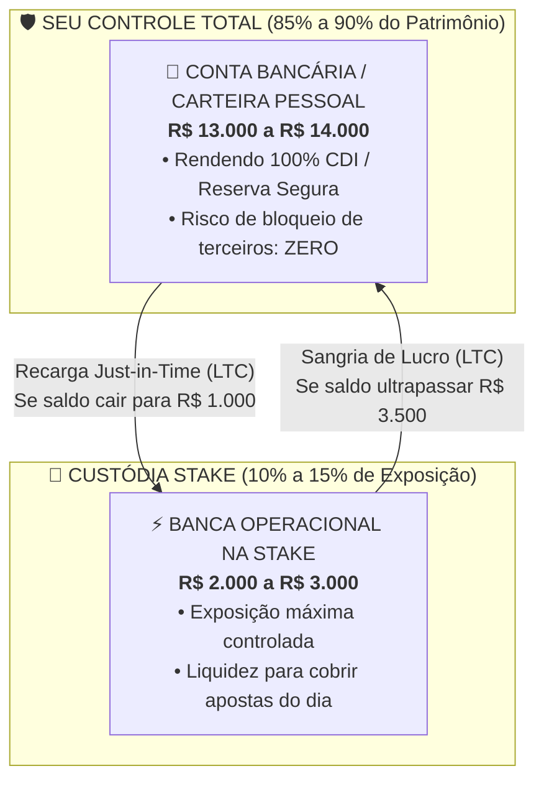

# Estratégia de Aporte e Gestão de Risco: Capital Fracionado na Stake.com

## 1. Visão Geral e Diagnóstico de Risco

Ao operar modelos quantitativos de apostas esportivas (+EV, Handicap Asiático e Cartões) utilizando plataformas internacionais de criptomoedas como a **Stake.com**, um dos erros mais comuns de gestão financeira é alocar o capital total de investimento (ex: **R$ 16.000,00**) diretamente sob a custódia da casa de apostas.

Deixar R$ 16.000,00 parados na Stake expõe a operação ao **Risco de Contraparte**:
1. **Bloqueios e Demandas Burocráticas de KYC:** Solicitações repentinas de comprovação de renda, verificação facial ou instabilidades temporárias de conta.
2. **Custo de Oportunidade:** Capital ocioso sem render juros (CDI / Selic) enquanto aguarda oportunidades de aposta.
3. **Assimetria de Risco:** Risco desnecessário de perda patrimonial significativa diante de falhas técnicas ou regulatórias externas.

**Regra de Ouro da Gestão de Banca:** *Nunca mantenha sob a custódia de qualquer casa de apostas um centavo a mais do que o estritamente necessário para rodar as operações imediatas.*

---

## 2. Princípio da Custódia Fracionada: Banca Virtual vs. Banca Custodiada

A solução profissional para anular o risco de contraparte sem comprometer a rentabilidade é a separação entre **Banca Teórica/Virtual** e **Banca Operacional Custodiada**:



| Componente | Localização | Valor Recomendado | Finalidade | Risco de Terceiros |
| :--- | :--- | :--- | :--- | :--- |
| **Banca Total de Referência** | Seu banco / Carteira privada | **R$ 16.000,00** | Serve apenas como **balizador matemático** para cálculo do tamanho da unidade de aposta (1%). | **Zero** |
| **Banca Operacional** | Stake.com (VM Hetzner) | **R$ 2.000 a R$ 3.000** | Gira as apostas ativas do dia. Cobre a oscilação natural dos 90 minutos. | **Risco máximo restrito a ~15%** |

---

## 3. A Dinâmica do Giro (*Turnover*): Lucro Alto com Pouco Saldo em Casa

Nas apostas esportivas quantitativas, o retorno financeiro mensal não depende de ter uma grande reserva estática parada na conta da casa, mas sim da **velocidade de rotação do capital (*Turnover*)**. 

Diferente de investimentos em renda fixa ou ações, onde o dinheiro fica preso por meses, uma aposta esportiva dura **apenas 90 minutos**:
- Uma aposta liquidada às 16h retorna com o lucro para a conta e já financia a entrada do jogo das 18h ou do dia seguinte.

### Simulação Prática do Giro Mensal:
- **Banca de Referência:** R$ 16.000,00
- **Unidade de Aposta Padrão (1%):** **R$ 160,00** por entrada
- **Depósito Real na Stake:** **R$ 2.500,00** (cobre tranquilamente 15 unidades de margem simultânea)
- **Frequência Operacional:** 4 a 5 apostas +EV por dia (~ R$ 640 a R$ 800 apostados por dia)

| Parâmetro | Estimativa Operacional |
| :--- | :--- |
| **Apostas por Dia** | 4 a 5 entradas de R$ 160,00 |
| **Volume Apostado por Dia** | ~ R$ 720,00 |
| **Volume Girado no Mês (Turnover)** | **~ R$ 21.600,00 acumulados** |
| **ROI Médio do Modelo (+EV)** | 8% a 12% sobre o volume girado |
| **Lucro Líquido Mensal Estimado** | **R$ 1.700,00 a R$ 2.500,00** |
| **Retorno sobre o Capital Depositado na Stake** | **68% a 100% ao mês sobre os R$ 2.500 alocados** |

> **Conclusão:** Você obtém um lucro expressivo de **R$ 1.700 a R$ 2.500 mensais** girando mais de **R$ 20.000** no mês, sem jamais ter colocado mais de **R$ 2.500** em risco de custódia na Stake.

---

## 4. Exemplificação do Aporte Inicial e Estratégia de Sustentabilidade das Apostas

### 4.1. Estudo de Caso Real: Dados Extraídos do Dashboard do Sistema (Ciclo de 1 Mês)

Para ilustrar de forma definitiva por que **não é necessário aportar R$ 13.000 ou R$ 16.000**, analisamos um ciclo real de 30 dias consolidado no painel de desempenho da plataforma:

| Indicador no Dashboard | Valor em Cripto (LTC) | Valor Estimado (BRL) | Significado Operacional Real |
| :--- | :--- | :--- | :--- |
| **Total Apostado (Simulado)** | `44,17670664 LTC` | ~ R$ 13.425,30 | **Volume Acumulado Girado**: soma de todos os palpites do mês usando o mesmo saldo várias vezes. |
| **Total Ganho** | `50,31124477 LTC` | ~ R$ 15.289,59 | **Retorno Bruto**: total devolvido pela casa em apostas green (valor apostado + lucro). |
| **Ganho Odds** | `18,68473888 LTC` | ~ R$ 5.678,29 | Lucro bruto gerado estritamente pela valorização das odds vencedoras. |
| **Total Perda** | `12,55020075 LTC` | ~ R$ 3.814,01 | Total consumido pelas apostas que resultaram em red durante a variância do mês. |
| **Saldo Líquido** 🟢 | **`+6,13453813 LTC`** | **~ +R$ 1.864,29** | **Lucro Líquido Realizado**: dinheiro limpo que sobrou no bolso ao final do ciclo. |

### 4.2. A Diferença Crucial: Volume Acumulado vs. Aporte Inicial

O equívoco clássico é olhar para o indicador **"Total Apostado: R$ 13.425,30"** e supor que esse montante precisa ser transferido integralmente no primeiro dia.

#### A Analogia do Comerciante:
* Um lojista com apenas **R$ 1.500 no bolso** compra R$ 400 em mercadoria de manhã e vende tudo à tarde por R$ 460.
* Ele repete essa rotina diariamente durante 30 dias.
* No balanço mensal, o sistema contábil registrará:
  * *Total de Compras:* R$ 12.000,00
  * *Total de Vendas:* R$ 13.800,00
  * *Lucro Líquido:* +R$ 1.800,00
* **O lojista precisou de R$ 12.000 de capital inicial?** **Não.** Ele precisou de apenas **R$ 1.500**. O mesmo capital circulou e retornou repetidamente.

### 4.3. Dimensionamento do Aporte Inicial e Sustentabilidade da Operação

No modelo esportivo de 90 minutos, as apostas não prendem o capital por semanas:
1. **Margem para Apostas Simultâneas:** O pipeline geralmente seleciona entre 2 a 4 partidas concomitantes em um mesmo dia. Com unidades de aposta de **~0,45 LTC (~ R$ 140 a R$ 150)**, a exposição máxima em trânsito no mesmo instante raramente ultrapassa **1,8 LTC (~ R$ 550 a R$ 600)**.
2. **Aporte Inicial Real Necessário:**
   * **4,5 a 6,0 LTC (apenas ~ R$ 1.500 a R$ 2.000)** depositados na Stake são plenamente suficientes para suportar o giro diário e a variância normal.
3. **Sustentabilidade e Preservação de Capital:**
   * **R$ 14.000 (88% do patrimônio):** Ficam intactos e seguros na sua conta bancária no Brasil rendendo 100% do CDI ou em carteira fria.
   * **R$ 2.000 (12% do patrimônio):** Ficam na Stake gerando os **+R$ 1.864,29 de lucro mensal**.
   * **Mitigação Total de Bloqueio:** No pior cenário teórico de instabilidade cadastral na Stake, o prejuízo máximo fica estritamente confinado aos R$ 1.500 a R$ 2.000 da banca operacional, eliminando qualquer risco de perda do patrimônio principal de R$ 16.000.

---

## 5. Política "Just-in-Time": Gatilhos de Sangria e Recarga via Litecoin (LTC)

Para manter a banca na Stake sempre na faixa ideal (entre R$ 2.000 e R$ 3.500), adota-se a política automatizada de **Sangria e Recarga rápida**:

```
[ SALDO > R$ 3.500 ] ──> SANGRIA IMEDIATA (Saque via LTC ➔ Carteira ➔ Binance/PIX)
[ SALDO ~ R$ 2.500 ] ──> ZONA DE OPERAÇÃO NORMAL (Execução autônoma de entradas)
[ SALDO < R$ 1.000 ] ──> RECARGA DE CONTINGÊNCIA (Aporte de R$ 1.000 via LTC)
```

### Por que o Litecoin (LTC) viabiliza essa estratégia?
1. **Taxa de Saque Fixa:** `0.000138 LTC` (~ R$ 0,06 por saque na Stake).
2. **Custo de Transferência na Carteira Pessoal:** ~ R$ 0,10.
3. **Custo Total por Ciclo:** Menos de **R$ 0,30** somando envio e conversão.
4. **Velocidade de Liquidação:** De 3 a 5 minutos para confirmação na rede.
5. **Impacto no Lucro:** Praticamente zero (inferior a 0,02% do lucro mensal).

### Diretrizes de Execução:
* **Gatilho de Sangria (Lucro Realizado):** Sempre que uma sequência de vitórias elevar o saldo da Stake para além de **R$ 3.500,00**, efetue o saque do excedente imediatamente. O lucro deve estar no seu bolso, não na casa.
* **Gatilho de Recarga (Drawdown Natural):** O futebol possui variância estatística. Caso ocorra uma sequência negativa pontual e o saldo na Stake caia para próximo de **R$ 1.000,00**, transfira uma recarga de R$ 1.000,00 a partir da sua carteira para reequilibrar a margem operacional.

---

## 6. Medidas de Compliance e Blindagem contra Bloqueios na Stake

Para afastar riscos cadastrais e exigências repentinas na Stake.com:

1. **Verificação Antecipada (KYC Níveis 1 e 2):**
   - Logo após o cadastro, realize a verificação de identidade oficial (envio de documento com foto e comprovante de endereço). Contas devidamente verificadas no nível 2 não sofrem travas unilaterais nem suspensões repentinas por saque de lucros.
2. **Estabilidade de Acesso:**
   - Acesse a Stake estritamente pelo ambiente remoto dedicado (`remote-browser` na VM Hetzner na Alemanha). Evite alternar conexões de celulares, VPNs públicas comerciais ou redes Wi-Fi instáveis.
3. **Rota Segura de Saque (Carteira Intermediária):**
   - Nunca transfira da Stake diretamente para a exchange (Binance Brasil). Siga rigorosamente o fluxo: **Stake ➔ Carteira Não-Custodial (Exodus/Trust) ➔ Binance Brasil ➔ PIX**.
4. **Isolamento de Risco Máximo:**
   - Seguindo esta cartilha, na eventualidade de qualquer divergência cadastral temporária, seu prejuízo máximo potencial fica limitado a uma fração de R$ 2.000 a R$ 2.500, mantendo 85% do seu patrimônio totalmente intocado no Brasil.

---

## 7. Dimensionamento Prático de Aporte: Stake de 0,33467 LTC (~ R$ 101,51) e Ciclos de 10 Apostas

### 7.1. Dinâmica de Caixa no Controle de Metas
No módulo de **Controle de Metas Diárias & Ciclos Rotativos**, as entradas são agrupadas em blocos sequenciais de 10 apostas:
* As 10 apostas do ciclo **não acontecem todas no mesmo segundo**: o pipeline seleciona tipicamente de 3 a 5 partidas por dia em horários espaçados (ex: 13h, 16h, 19h).
* O retorno das apostas vencedoras finalizadas retorna à conta e retroalimenta imediatamente as entradas seguintes do mesmo ciclo.
* A taxa histórica de não-perda do modelo (vitória ou reembolso) situa-se em torno de **79%**, o que reduz drasticamente a necessidade de capital ocioso travado.

### 7.2. Tabela de Dimensionamento de Aporte Inicial

Com a **Stake Padrão por Aposta de `0,33467202 LTC` (~ R$ 101,51)**:

| Nível de Gestão | Unidades de Cobertura | Quantidade em LTC | Valor Estimado em Reais (BRL) | Perfil Operacional |
| :--- | :---: | :---: | :---: | :--- |
| **Mínimo Operacional** | **10 unidades** *(1 ciclo inteiro)* | `3,35 LTC` | **~ R$ 1.015,00** | Cobre 10 apostas consecutivas mesmo no cenário improvável de 10 reds simultâneos. Margem justa. |
| **Recomendado (Ideal)** 🥇 | **15 unidades** *(1,5 ciclos)* | **`5,02 LTC`** | **~ R$ 1.520,00 a R$ 1.550,00** | **Melhor equilíbrio entre segurança e liquidez**. Absorve a variância normal de mercado e picos de jogos simultâneos sem demandar recargas intermediárias. |
| **Ultra-Conservador** | **20 unidades** *(2 ciclos inteiros)* | `6,70 LTC` | **~ R$ 2.030,00** | Autonomia prolongada para cobrir até 2 a 3 ciclos com margem folgada. |

### 7.3. Recomendação Estratégica para Início do Empreendimento

Para iniciar a operação com máxima tranquilidade e estabilidade operacional, o aporte recomendado é de:

> **Aporte Inicial Ideal:** **R$ 1.550,00 a R$ 1.600,00** $\;\longrightarrow\;$ **~ 5,10 a 5,20 LTC**

#### Vantagens Estratégicas:
1. **Margem Folgada de 15 Unidades:** Permite rodar 1 ciclo e meio sem depender de retorno financeiro imediato.
2. **Buffer de Taxas e Cotação:** A folga de R$ 30 a R$ 50 absorve pequenas oscilações de preço do Litecoin e eventuais taxas residuais na conversão da corretora.
3. **Preservação de 90% do Capital Total:** Mantém **R$ 14.400** da banca global de R$ 16.000 rendendo juros com risco zero na sua conta bancária no Brasil.
4. **Ciclo Perfeito de Sangria:** Conforme os ciclos rotativos (#64, #65...) acumularem lucros e o saldo na Stake atingir a faixa de ~ R$ 2.500 a R$ 3.000, aciona-se o gatilho de sangria via PIX, trazendo o lucro realizado para o bolso e redefinindo a banca de giro nos 5 LTC.

### 7.4. Rota Rápida de Aquisição e Início da Operação:
1. **PIX para a Binance Brasil:** Deposite **R$ 1.550,00** a partir da sua conta bancária nacional.
2. **Ordem de Compra:** Adquira Litecoin no par de negociação `LTC/BRL`.
3. **Transferência de Proteção:** Saque os ~5,15 LTC da Binance para sua carteira privada (Trust Wallet ou Exodus).
4. **Depósito na Stake:** Envie os LTC da sua carteira privada diretamente para o endereço de depósito da Stake.com e inicie as apostas do ciclo.

---

## 8. Ponto de Atenção: Rota de Transferência (Binance vs. Carteira Intermediária)

> [!IMPORTANT]
> **Ponto de atenção:**
> * **Se for um teste rápido com valor pequeno:** Pode mandar direto da Binance para o Thunderpick.
> * **Se for movimentar banca com frequência e realizar saques regulares:** Vale muito a pena baixar uma carteira rápida (como **Trust Wallet** ou **Exodus**) para servir de intermediária e blindar sua conta da Binance.


