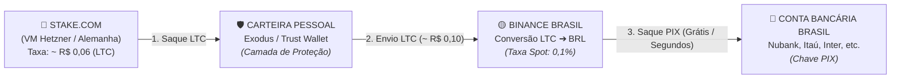

# Estratégia de Apostas em Criptomoedas na Stake (Operação na Alemanha e Saques via Binance Brasil / PIX)

## 1. Visão Geral e Contexto
Em modelos quantitativos de apostas esportivas (+EV, Handicap Asiático e Cartões) com **ROI médio projetado de 10% a 15%**, a contenção de custos de fricção (taxas de depósito, saque, taxas de rede blockchain e spread cambial) é crucial para a preservação do lucro líquido da banca.

Este documento estabelece as diretrizes de viabilidade matemática, controle de custos e a rota segura de liquidação financeira entre a **Stake.com** (operada remotamente na VM Hetzner na Alemanha), a **Binance Brasil** e o sistema bancário brasileiro via **PIX**.

---

## 2. Tabela de Limites e Taxas de Saque da Stake (*Withdrawal Fees*)

Abaixo estão os parâmetros oficiais da Stake para as principais criptomoedas suportadas (com estimativas convertidas para Euros/Dólares e Reais):

| Criptomoeda | Saque Mínimo (*Min Amount*) | Taxa de Saque Fixa (*Withdrawal Fee*) | Custo Estimado (EUR / USD) | Custo Estimado em Reais (BRL) | Nível de Impacto no ROI |
| :--- | :--- | :--- | :--- | :--- | :--- |
| **LTC (Litecoin)** 🥇 | `0.01857329 LTC` | `0.00013800 LTC` | **~ € 0,01** (< 1 centavo) | **~ R$ 0,06** (centavos) | **Desprezível (Ideal)** |
| **XRP (Ripple)** 🥇 | `1.00000000 XRP` | `0.00010000 XRP` | **< € 0,001** (micro-centavo) | **< R$ 0,01** (fração) | **Desprezível (Ideal)** |
| **BCH (Bitcoin Cash)** | `0.00405806 BCH` | `0.00004000 BCH` | **~ € 0,01 a € 0,02** | **~ R$ 0,10** | **Muito Baixo** |
| **EOS** | `1.87644594 EOS` | `0.10788480 EOS` | **~ € 0,05** | **~ R$ 0,30** | **Muito Baixo** |
| **DOGE (Dogecoin)** | `5.49925970 DOGE` | `0.52151198 DOGE` | **~ € 0,06 a € 0,10** | **~ R$ 0,40 a R$ 0,60** | **Muito Baixo** |
| **BTC (Bitcoin)** | `0.00002504 BTC` | `0.00001571 BTC` | **~ € 1,00 a € 1,40** | **~ R$ 6,00 a R$ 8,50** | **Médio** (não sacar valores baixos) |
| **USDT (Tether)** | `2.50000000 USDT` | `1.00000000 USDT` | **~ € 0,92 ($ 1,00 fixo)** | **~ R$ 5,60 fixo** | **Médio** (desfavorável p/ saques pequenos) |
| **ETH (Ethereum)** ⚠️ | `0.00100000 ETH` | `0.00067447 ETH` | **~ € 1,60 a € 2,50** | **~ R$ 10,00 a R$ 15,00** | **Alto** (gás elevado da rede ERC-20) |

---

## 3. Simulação de Impacto Real no Lucro (Banca com 10% a 15% de ROI)

Como as taxas de rede são **fixas por evento**, seu impacto sobre a banca diminui expressivamente conforme o montante sacado.

### Cenário de Exemplo:
- **Banca Operacional:** R$ 5.000,00 (~ € 830,00)
- **Lucro do Período (15% ROI):** R$ 750,00 (~ € 125,00)
- **Saque de Lucro Realizado:** R$ 2.500,00 utilizando **Litecoin (LTC)**

| Etapa da Transação | Mecanismo | Taxa Cobrada | Custo Estimado |
| :--- | :--- | :--- | :--- |
| **1. Saque da Stake** | Rede Litecoin (`0.000138 LTC`) | Fixa da Stake | R$ 0,06 |
| **2. Envio da Carteira Pessoal** | Taxa de Mineração LTC | Rede Blockchain | R$ 0,10 |
| **3. Depósito na Binance** | Endereço LTC Binance Brasil | Isento | R$ 0,00 |
| **4. Conversão Spot (LTC ➔ BRL)** | Ordem Market/Limit Binance | 0,10% (padrão) | R$ 2,50 |
| **5. Saque Bancário via PIX** | Binance ➔ Conta Bancária no Brasil | Geralmente Isento / Parceria | R$ 0,00 a R$ 2,60 |
| **Custo Total da Operação** | — | — | **~ R$ 2,66 a R$ 5,26** |

> **Resultado no ROI:** Em um lucro de **R$ 750,00**, um custo total de **~ R$ 3,00 a R$ 5,00** representa menos de **0,6% do lucro obtido**. O seu ROI líquido permanece praticamente intacto (mantendo 14,9% dos 15% projetados).

---

## 4. Comparativo Estratégico: Stake Cripto vs. Casas Reguladas na Alemanha

A operação via Stake em cripto é incomparavelmente superior ao modelo de apostas reguladas locais:

| Critério | Casas Licenciadas na Alemanha (Betano, Bet365, etc.) | Stake.com (Cripto Internacional) |
| :--- | :--- | :--- |
| **Imposto por Aposta (*Sportwettensteuer*)** | **5,3% retido na fonte** sobre cada aposta ou retorno bruto. | **0%** retido na fonte. |
| **Impacto no ROI de 10% a 15%** | **Destrói entre 35% e 50% de todo o lucro**. | Custo inferior a **1% do lucro** (via LTC). |
| **Limitações de Conta (*Account Limits*)** | Altamente agressivas para apostadores lucrativos. | Liquidez muito maior para apostadores de valor (+EV). |
| **Acesso a Mercados Asiáticos** | Severamente restrito pela regulamentação da GGL. | Linhas asiáticas completas e líquidas. |
| **Liquidação Financeira** | Presa ao sistema bancário europeu e burocracia local. | **Direto na conta bancária brasileira via PIX**. |

---

## 5. Rota Segura de Compliance (Prevenção de Travas na Binance Brasil)

A Binance Brasil opera com identificação por CPF e obedece a regras de compliance financeiro. Para garantir que sua conta nunca receba alertas automáticos de depósito direto originado de cassinos ou casas de apostas internacionais, a arquitetura utiliza uma **carteira intermediária não-custodial**:

### Arquitetura de Saque Recomendada:

1. **Passo 1 (Stake ➔ Carteira Pessoal):**
   - Saque em Litecoin para a sua carteira não-custodial privada (Exodus ou Trust Wallet).
   - Taxa: `0.000138 LTC` (~ R$ 0,06).
2. **Passo 2 (Carteira Pessoal ➔ Binance Brasil):**
   - Envio da sua carteira pessoal para o seu endereço de depósito LTC na Binance.
   - Custo da rede Litecoin: ~ R$ 0,10.
   - **Benefício de Segurança:** O depósito recebido pela Binance provém de um endereço privado de pessoa física, eliminando qualquer associação direta com casas de apostas.
3. **Passo 3 (Conversão e PIX Instantâneo):**
   - Venda do Litecoin no par `LTC/BRL` (ou `LTC ➔ USDT ➔ BRL`).
   - Saque em Reais via **PIX** direto para sua conta bancária no Brasil (Nubank, Itaú, Inter, Bradesco, etc.). O crédito ocorre em poucos segundos.

---

## 6. Diretrizes e Regras de Ouro Operacionais

1. **Nunca utilize USDT ou ETH para saques fracionados:** O custo fixo de $ 1,00 a $ 2,50 por transação penaliza saques de pequenos valores.
2. **Adote Litecoin (LTC) como moeda padrão de giro:** Apresenta a melhor combinação de liquidez na Binance Brasil, confirmações rápidas e taxa quase nula (< R$ 0,20 somando as duas pontas).
3. **Mantenha a frequência de saques planejada:** Agrupe os saques quinzenalmente ou mensalmente para manter a gestão de banca disciplinada.
4. **Isolamento de Conexão:** Mantenha o acesso à Stake sempre restrito ao **remote-browser** da VM isolada, preservando a sessão sem bloqueios territoriais.

---

## 7. Guia Prático: Carteiras Não-Custodiais (O que são e como obter)

### 7.1. O que é uma Carteira Não-Custodial (*Autocustódia*)?
A diferença fundamental entre uma corretora (como a Binance) e uma carteira não-custodial (como Trust Wallet ou Exodus) é a titularidade e o controle dos fundos:

| Tipo | O que é? | Exemplos | Como funciona? |
| :--- | :--- | :--- | :--- |
| **Custodial** *(com custódia)* | É como uma **conta bancária**. | **Binance**, Mercado Bitcoin | A corretora guarda as moedas para você. Você possui login e senha, mas a empresa controla os fundos e monitora a procedência de cada transação. |
| **Não-Custodial** *(autocustódia)* | É como a **sua carteira física no bolso**. | **Trust Wallet**, **Exodus**, Coinomi | É um aplicativo (celular ou PC) onde **apenas você** tem a chave privada. Não requer cadastro, email, nome nem envio de documentos. |

### 7.2. Por que usar a Carteira Não-Custodial como "Ponte"?
- **Risco do Saque Direto (Stake ➔ Binance):** A blockchain é pública. Exchanges podem sinalizar contas que recebem depósitos diretos recorrentes de *hot wallets* de plataformas de jogos internacionais.
- **Proteção via Carteira Pessoal (Stake ➔ Carteira ➔ Binance):** A transação enviada da sua carteira para a Binance tem como remetente um endereço particular de pessoa física, eliminando qualquer vínculo direto com casas de apostas e blindando sua conta na Binance Brasil.

### 7.3. Passo a Passo: Como Obter e Configurar (Menos de 3 minutos)

#### Passo 1: Download do Aplicativo Oficial
- **No Celular (iOS / Android):** Baixe a **Trust Wallet** ou o **Exodus** diretamente da loja oficial de aplicativos.
- **No Computador (Desktop):** Baixe pelo site oficial: `https://www.exodus.com/`.

#### Passo 2: Criação da Carteira
1. Abra o aplicativo e selecione **"Criar uma nova carteira"** (*Create a new wallet*).
2. Defina uma senha ou PIN de acesso local no seu dispositivo.

#### Passo 3: Backup das 12 Palavras de Segurança (*Seed Phrase*) ⚠️
- O aplicativo exibirá uma sequência de **12 palavras em inglês** (ex: *apple, chair, river, moon...*).
- Essa sequência é a **chave mestra irrecuperável** dos seus fundos: com ela, você recupera seu saldo em qualquer outro dispositivo caso perca o celular ou PC.
- **Regra de Segurança:** Anote as 12 palavras em um **caderno físico** e guarde em local seguro. Nunca tire captura de tela (print) e nunca salve em nuvem, bloco de notas ou mensagens.

### 7.4. Ciclo de Operação na Prática

1. **Receber o Saque da Stake:**
   - No app da carteira (Exodus/Trust Wallet), selecione **Litecoin (LTC)** e clique em **"Receber"** (*Receive*).
   - Copie o endereço exibido (inicia com `L`, `M` ou `ltc1...`) e informe-o na Stake no momento do saque.
2. **Transferir para a Binance Brasil:**
   - Quando o saldo em LTC chegar na sua carteira (cerca de 2 a 5 minutos):
   - Abra a Binance, vá em **Depósito ➔ Cripto ➔ LTC (Litecoin)** e copie seu endereço de depósito na Binance.
   - Na sua carteira pessoal, selecione **Litecoin ➔ "Enviar"** (*Send*), cole o endereço da Binance e confirme o envio (custo de rede ~ R$ 0,10).
3. **Conversão e Saque via PIX:**
   - O saldo chega na Binance limpo e sem marcação de cassino.
   - Converta para Reais no par `LTC/BRL`.
   - Realize o saque via **PIX** para sua conta bancária no Brasil. O valor cai em segundos na sua conta.
