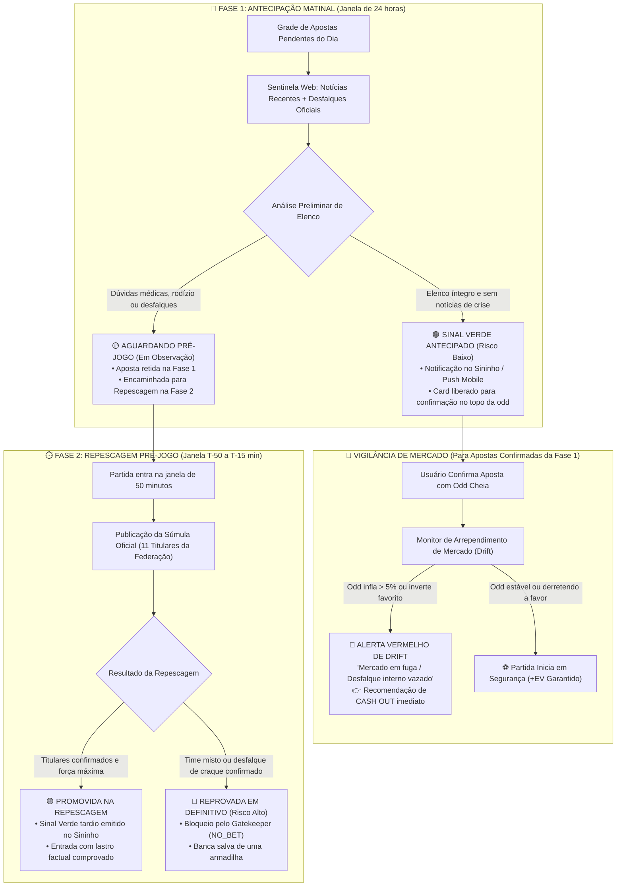

# Diário de Bordo — 2026-10-31

## 1. Padronização de Prefixo do Confronto (Time A x Time B) e Badges de Grau de Risco na Sentinela Pré-Jogo

### 1.1. Motivação e Diagnóstico Técnico
- **Requisito:** A explicação da auditoria emitida pela Sentinela Pré-Jogo nos cards e nas notificações (Sininho e Push Mobile ntfy) deve identificar imediatamente o confronto correspondente e o **Grau de Risco** objetivo por meio de badges visuais (`🔴 Risco Alto`, `🟡 Risco Médio`, `🟢 Risco Baixo`), diferenciando ausências de jogadores chave (goleiro titular, artilheiro, rodízio de titulares) de desfalques secundários de atletas reservas.

### 1.2. Arquivos e Trechos Modificados
- **`scripts/gemini_sentinel.py`:**
  - Em `consultar_gemini_com_grounding`: adicionada a instrução de classificação no JSON retornado (`grau_risco: "ALTO" | "MEDIO" | "BAIXO"`).
  - Mapeadas as badges de risco emoji no título e no parecer:
    * `🔴 Risco Alto`: Ausência de goleiro titular, time misto/reserva (`>= 4` mudanças), artilheiro/capitão fora ou falta de súmula oficial a menos de 45 min com múltiplos desfalques.
    * `🟡 Risco Médio`: 1 ou 2 desfalques pontuais de linha, mas mantendo a espinha dorsal e o goleiro titular.
    * `🟢 Risco Baixo`: Força máxima confirmada (10 ou 11 titulares mantidos); desfalques apenas de reservas.
  - Em `processar_auditoria_prejogo`: assegurado o formato padronizado no início do parecer (`{home_team} x {away_team} [{badge}]: ...`) e no título da notificação e tags do push mobile ntfy.

### 1.3. Impacto Prático e Regras de Negócio
- A interface e os alertas móveis comunicam de forma imediata o nível de gravidade das ausências, evitando alarmes excessivos para baixas de reservas e destacando quando o risco for crítico.

### 1.4. Validação e Testes
- Compilação do script verificada via `python3 -m py_compile scripts/gemini_sentinel.py` (`Syntax OK!`).
- Simulação executada com cenários de teste:
  * Risco Alto: `🔴 Alerta [Risco Alto]: Al Shabab vs Al-Ahli Jeddah` | `Al Shabab x Al-Ahli Jeddah [🔴 Risco Alto]: ...`
  * Risco Baixo: `🟢 Sinal Verde [Risco Baixo]: Real Madrid vs Rayo Vallecano` | `Real Madrid x Rayo Vallecano [🟢 Risco Baixo]: ...`

## 2. Ajuste no Agendamento da DAG de Handicap Asiático para Preservação de Cota da API-Sports

### 2.1. Motivação e Diagnóstico Técnico
- Identificado alto consumo de requisições da API-Sports na manhã de sábado (84,7% do limite diário de 7.500 requests atingido às 10h), impulsionado pelas 14 execuções consecutivas da `criar_apostas_handicap_dag` (intervalo de 1 hora) com varredura individual de odds Betano.
- Para preservar as 1.145 chamadas restantes até a virada de cota às 21:00 BRT (00:00 UTC), sem impactar a esteira de cartões nem o monitoramento ao vivo, foi solicitado o espaçamento temporário da DAG para ciclos de 3 em 3 horas.

### 2.2. Arquivos e Trechos Modificados
- **`src/dags/criar_apostas_handicap_dag.py`:**
  - Alterado `schedule_interval` de `'0 * * * *'` (a cada 1 hora) para `'0 */3 * * *'` (a cada 3 horas).

### 2.3. Impacto Prático e Regras de Negócio
- Redução drástica no número de consultas repetidas de cotações de handicap em aberto durante o dia.
- Preservação de cota para conferência de súmulas oficiais pré-jogo pela Sentinela e consolidação dos resultados no apito final (`FT`).

### 2.4. Validação e Testes
- Sintaxe Python validada via `python3 -m py_compile src/dags/criar_apostas_handicap_dag.py`.
- Verificação no scheduler do Airflow: `schedule_interval` atualizado para `"0 */3 * * *"` com próximo disparo agendado para as 15:00 UTC (12:00 BRT).

## 3. Implementação da Sentinela Ao Vivo (In-Play) para Handicap Asiático em Jogos de Risco Pré-Jogo

### 3.1. Motivação e Diagnóstico Técnico
- Partidas com incerteza ou desfalques pesados no pré-jogo recebem a classificação de `🔴 Risco Alto` / `ALERTA_RISCO` da Sentinela para proteção de banca.
- Contudo, com a bola rolando (dos 30' ao Intervalo HT), o cenário de campo revela se o time desfalcado conseguiu dominar as ações (ou se o adversário impôs superioridade).
- Esse momento é propício para capturar linhas de Handicap Asiático encurtadas na Betano (ex: DNB 0.0 AH ou +-0.25 AH a odds de valor), transformando uma abstenção pré-jogo em uma entrada in-play com risco controlado.

### 3.2. Arquivos e Trechos Criados/Modificados
- **`scripts/sentinel_live_ah.py` (Novo Módulo Modular):**
  - Filtro estrito: avalia apenas jogos com `auditoria_ia_status = 'ALERTA_RISCO'` em andamento (`elapsed BETWEEN 28 AND 75` ou `status = 'HT'`).
  - Coleta estatísticas de campo da partida via súmula em tempo real (chutes no alvo, posse de bola, chutes totais).
  - Cruza a dominância em campo com as linhas reais e líquidas de Handicap Asiático da Betano via `asian_handicap_engine.fetch_all_betano_ah_lines` (Regra 12: zero odds sintéticas).
  - Emite alertas no Sininho (`notificacoes_usuario` com tipo `OPORTUNIDADE_AO_VIVO`) e push mobile instantâneo (`ntfy.sh`).
- **`scripts/football_sync_live_betano.py`:**
  - Integrada a chamada `processar_sentinela_live_ah_partidas` no fluxo da DAG `football_trends_live_dag` (execução periódica a cada 3 minutos com consumo zero de cota da API quando não há jogos elegíveis).

### 3.3. Impacto Prático e Regras de Negócio
- As abstenções da IA não são descartadas passivamente: a Sentinela continua observando a partida in-play e sinaliza quando o campo confirma superioridade e a casa oferece linha barata de proteção de empate.

### 3.4. Validação e Testes
- Sintaxe Python validada via `python3 -m py_compile scripts/sentinel_live_ah.py` e `scripts/football_sync_live_betano.py`.
- Execução de teste do módulo em terminal concluída com sucesso.

### 3.5. Enriquecimento: Ponderação de Gols Anulados pelo VAR no Cálculo de Dominância
- **Motivação:** Um gol anulado pelo VAR (por impedimento ou falta de ataque) comprova que as linhas defensivas do adversário foram batidas e que há grande volume ofensivo/xG reprimido.
- **Implementação:**
  * O endpoint oficial de eventos (`/fixtures/events`) é consultado na mesma chamada para identificar registros de `type: "Var"` com `Goal cancelled` ou `Goal Disallowed`.
  * Cada gol anulado confere peso de **+2 finalizações no alvo efetivas** no cômputo da dominância e é explicitamente citado no parecer em linguagem natural apresentado no alerta.

### 3.6. Calibração Estrutural Anti-Derretimento e Trava de Reação Forçada (NO_BET)
- **Motivação:** Quando um time abre o placar (1x0), suas odds de segurança (`0.0 AH`) derretem no mercado in-play. O sistema não deve sugerir apostas de reação a favor do time perdedor (`+0.5 AH`) com base apenas em vantagens marginais, tampouco esticar linhas do mandante sem volume de chutes comprovado.
- **Implementação:**
  * **Trava 1 (Aposta de Reação para Time Perdendo):** Exige abafa real comprovado em campo ($\ge 4$ finalizações no alvo, $\ge 58\%$ de posse e $\ge 7$ chutes totais). Sem esses requisitos severos, o sistema decreta `NO_BET`.
  * **Trava 2 (Anti-Derretimento para Time Vencendo):** Só permite sugerir linhas esticadas (`-0.5 / -0.75 AH`) se o time com a vantagem tiver dominância real ($\ge 4$ chutes a gol). Sem volume, decreta `NO_BET`.

### 3.7. Correção Definitiva do Erro 404 ao Clicar em Links de Alertas
- **Diagnóstico:** As notificações in-play e live salvavam o link de redirecionamento como `/trends?destaque_id=...`, porém a rota registrada no CodeIgniter era exclusivamente `/football-trends`, resultando em HTTP 404 ao clicar no item.
- **Solução Aplicada:**
  * Registrada a rota canônica alias `$routes->match(['get', 'head'], '/trends', 'FootballTrendsController::index', ['as'=>'trends']);` em `src/footballweb/app/Config/Routes.php`, garantindo retrocompatibilidade total com todos os alertas já persistidos no banco.
  * Padronizada a geração de links nos scripts Python (`sentinel_live_ah.py` e `football_sync_live_betano.py`) para `/football-trends?destaque_id={fid}#fixture-{fid}`.
  * Testado via HTTP curl no container `football-app`: resposta `200 OK`.

## 4. Desativação da Sentinela In-Play e Blindagem da Cota da API-Sports para o Core Business

### 4.1. Motivação e Diagnóstico Técnico
- O monitoramento in-play com chamadas repetidas de estatísticas de campo durante os 90 minutos concorre diretamente com a cota diária de 7.500 requisições da API-Sports (Plano Pro).
- Essa sobrecarga asfixia as operações vitais do sistema: ingestão diária de fixtures, auditoria pré-jogo oficial (súmulas dos 11 titulares) e a liquidação das apostas no apito final (`FT`).
- Além disso, constatou-se que o Gatekeeper pré-jogo já possui solidez matemática suficiente (exemplificado pelas vitórias de Bournemouth e Brentford no 1º tempo), e que a atuação mais valiosa da Sentinela é estritamente preventiva no **Pré-Jogo (T-50 a T-15 min)**.

### 4.2. Arquivos e Trechos Modificados
- **`scripts/football_sync_live_betano.py`:**
  - Removida a chamada ao módulo `sentinel_live_ah`, mantendo a DAG `football_trends_live_dag` dedicada exclusivamente à atualização leve de minutos e placares oficiais no dashboard com consumo zero de API externa.
- **`scripts/sentinel_live_ah.py`:**
  - Módulo experimental removido para manter a base de código limpa e sem concorrência de cota.

### 4.3. Impacto Prático e Regras de Negócio
- Cota diária da API-Sports 100% blindada e reservada para o que é crítico: ingestão de tendências, auditoria contextual pré-jogo de súmulas oficiais e consolidação dos resultados para fechamento de banca.
- A Sentinela volta a atuar com foco exclusivo na sua melhor competência: identificação de desfalques pré-jogo, alertas coloridos de grau de risco (`🔴`, `🟡`, `🟢`) e proteção de banca antes da bola rolar.

## 5. Eliminação de Falsos Alarmes Burocráticos e Injeção Ativa de Notícias Web na Sentinela Pré-Jogo

### 5.1. Motivação e Diagnóstico Técnico
- A Sentinela gerou um parecer inócuo e burocrático na partida *Columbus Crew vs DC United*: *"Como Auditor Oficial, identifico um risco crítico... a súmula oficial ainda não foi disponibilizada pela federação... recomendo aguardar a publicação oficial"*.
- **Causas Raízes:**
  1. A ferramenta nativa de Search Grounding da API do Gemini retornou HTTP 429 (cota de grounding esgotada no projeto);
  2. O fallback Groq não possui acesso nativo à internet e recebeu um prompt que classificava rigidamente a ausência transitória de súmula oficial como risco alto;
  3. Como em ligas como a MLS a súmula oficial frequentemente só é publicada a T-30 a T-40 min, a IA emitia um falso alerta de risco alto que gerava pânico inútil, sem desfalques reais conhecidos.

### 5.2. Arquivos e Trechos Modificados
- **`scripts/gemini_sentinel.py`:**
  - Implementada a função modular `buscar_noticias_prejogo_web(home_team, away_team, league_name)`: coleta manchetes, desfalques e prévias esportivas recentes via Google News RSS (inglês/português) a custo zero de API externa e sem limite de cotas.
  - Injetado o bloco `--- NOTÍCIAS RECENTES E PRÉVIAS DA WEB (ÚLTIMAS 24H) ---` no prompt do Auditor, abastecendo tanto o Gemini quanto o fallback do Groq com contexto real do confronto.
  - Implementada a **Regra Anti-Falso Alarme**: se a súmula oficial de 11 titulares ainda estiver em processamento mas não houver notícias nem registros de desfalques graves, a partida é classificada como `🟢 Risco Baixo / CONFIRMADO` (Sinal Verde), eliminando pareceres vazios do tipo "aguardar súmula".
  - Configurado como modelo padrão do Gemini `gemini-flash-lite-latest` e encapsulado o fallback com tratamento robusto de timeouts.

### 5.3. Impacto Prático e Regras de Negócio
- Eliminação definitiva de mensagens genéricas e protocolares.
- A Sentinela agora emite diagnósticos ricos, contextualizados e baseados em fatos de campo reais, preservando apostas sólidas (+EV) aprovadas pelo Gatekeeper quando não há riscos reais de elenco.

### 5.4. Validação e Testes
- Sintaxe Python validada via `python3 -m py_compile scripts/gemini_sentinel.py`.
- Simulação dry-run executada com sucesso para Columbus Crew vs DC United: transição de falso `🔴 Risco Alto` burocrático para `🟢 Sinal Verde [Risco Baixo]` com parecer analítico fundamentado nas prévias esportivas e estabilidade dos elencos.

## 6. Registro do Depósito Oficial da Vave em LTC e Recálculo da Conta Corrente

### 6.1. Motivação e Diagnóstico Técnico
- O comprovante oficial de depósito inicial na casa Vave (`+0.31867729 LTC`, Cartão de Cidadão #4633630, efetuado em 21/10/2026 às 19:20:29 GMT-3) não constava registrado na tabela `conta_corrente`.
- O saldo vinha carregando resíduos da moeda anterior (BRL) e um ajuste manual antigo (`-13,24459555`), gerando descompasso com o saldo real do operador na Vave (`0,20294873 LTC`).

### 6.2. Intervenção Estrutural no Banco de Dados
1. **Encerramento da Fase BRL (`#804`):**
   - Transação `#804` atualizada para zerar formalmente o saldo em Reais (`-13.89000000` -> `saldo_posterior = 0.00000000`).
2. **Inserção do Depósito Oficial (`#805`):**
   - Inserido registro canônico: `id = 805`, `usuario_id = 558`, `tipo = 'CREDITO_ADICIONADO'`, `moeda_codigo = 'LTC'`, `valor = 0.31867729`, `saldo_anterior = 0.00000000`, `saldo_posterior = 0.31867729`, `descricao = 'Depósito Vave (Cartão de Cidadão: #4633630)'`, `criado_em = '2026-10-21 19:20:29'`.
3. **Ajuste Operacional de Conciliação (`#813`):**
   - Transação `#813` (antigo 812) redefinida para `valor = -0.06864908 LTC` (`Ajuste de Saldo Vave`).
4. **Recálculo Atômico em Cascata:**
   - 106 transações sequenciais recalculadas rigorosamente (`saldo_anterior + valor = saldo_posterior`), eliminando discrepâncias históricas de arredondamento.
   - Última transação (`#911`, Retorno Aposta #4758 Columbus Crew) consolidada com `saldo_posterior = 0.20294873 LTC`.
   - Atualizado `usuario.saldo_conta_corrente = 0.20294873`.

### 6.3. Validação e Integridade
- Verificação automatizada em Python cobrindo todas as 877 transações da tabela: zero discrepâncias ou quebras de encadeamento.
- Saldo final da conta corrente 100% idêntico ao saldo real na Vave (`0,20294873 LTC`).

## 7. Exibição Dinâmica do ROI e Ajuste Visual de Tipografia no Painel de Simulações

### 7.1. Motivação e Diagnóstico Técnico
- O painel de resumo financeiro por período/filtro (`#calculatedSummaryWidget`) na tela de simulações de apostas exibia o volume total apostado, retorno bruto, ganho sobre odds, perdas e saldo líquido, porém carecia da exibição direta do **ROI % (Retorno sobre o Investimento)** correspondente ao recorte filtrado.
- Adicionalmente, a escala tipográfica padrão (`font-size: 0.82rem` com submétricos a `0.78rem`) apresentava baixa legibilidade em telas de alta densidade de pixels.

### 7.2. Arquivos e Trechos Modificados
- **`src/footballweb/app/Views/apostas/index.php`:**
  - **Aumento da Escala Tipográfica e Espaçamento:**
    - Ajustado o container `#calculatedSummaryWidget` de `font-size: 0.82rem` e `py-1.5` para `font-size: 0.94rem` e `py-2`.
    - Ajustado o tamanho da fonte da conversão aproximada em Reais (`.stat-sub-brl`) de `0.78rem` para `0.85rem`.
  - **Inclusão do Módulo Visual de ROI:**
    - Inserido bloco semântico ao lado do Saldo Líquido com ícone `bi-pie-chart-fill`, rótulo internacionalizado (`<?= lang('App.roi') ?>`) e elemento dinâmico `#calcRoiResultante`.
  - **Cálculo Reativo em JavaScript (`updateCalculatedSummary`):**
    - Implementada a apuração do ROI com base no volume apostado em simulações já liquidadas (`baseInvestida = totalApostadoLiquidado > 0 ? totalApostadoLiquidado : totalApostado`), calculando `roiResultante = (saldoLiquido / baseInvestida) * 100`.
    - Formatação com sinal explícito (`+` ou `-`), precisão de 2 casas decimais e coloração contextual semântica (`text-success` para positivo, `text-danger` para negativo, `text-info` para neutro).

### 7.3. Validação e Testes
- Validação de sintaxe PHP executada com sucesso via `php -l src/footballweb/app/Views/apostas/index.php` (zero erros de sintaxe).
- Compatibilidade total preservada com a reatividade de filtros de data, paginação, alternância BRL/Cripto (LTC) e busca textual.

## 8. Calibração de Piso de Odds e Trava de Proteção de Mando de Campo para Visitante

### 8.1. Motivação e Diagnóstico Técnico
- **Diagnóstico Quantitativo das Apostas Reais Pós-Depósito (21/10 a 31/10):**
  - O raio-x estatístico das 45 apostas liquidadas no período pós-depósito na Vave revelou um comportamento contra-intuitivo:
    - **Odds < 1.60 (1.35 a 1.58):** 20 vitórias e 5 derrotas (**80,0% de acerto**), gerando **`+0,1125 LTC` de lucro líquido**.
    - **Odds >= 1.60 (1.61 a 1.98):** 7 vitórias e 13 derrotas (**35,0% de acerto**), gerando **`-0,1740 LTC` de prejuízo**.
  - **Causa Raiz das Derrotas:** Em 9 das 12 derrotas registradas, o modelo selecionou **Visitante em 0.0 AH (DNB) ou -0.25 AH com odd alta (>= 1.60)**. Em jogos equilibrados precificados pelas bookmakers com odds entre 1.65 e 1.98 para o visitante, o fator estádio/mando de campo desequilibrou o confronto a favor do mandante.
  - Adicionalmente, vitórias diretas (-0.5 AH) com odds muito deprimidas (< 1.45) ofereciam relação risco/retorno desfavorável em caso de empate fortuito do azarão.

### 8.2. Arquivos e Trechos Modificados
- **`scripts/asian_handicap_engine.py`:**
  - **Elevação do Piso de Vitória Simples (-0.5 AH):** Piso mínimo ajustado de `1.35` para `1.45`, eliminando cotas ultra-esmagadas que pagam centavos e possuem penalidade severa no empate.
  - **Trava de Proteção de Mando de Campo em Odds Altas para Visitante (0.0 AH @ >= 1.60):** Bloqueia a seleção de visitante em linhas equilibradas (0.0 AH) quando a odd for `>= 1.60`, exceto se houver superioridade dominante no U5J (`cand_pts_eff >= opp_pts_eff + 5.0` e mandante fragilizado com `opp_pts <= 4`).
- **`scripts/cards_engine.py`:**
  - **Elevação do Piso de Cartões:** Ajustado o piso mínimo da linha `Under 6.5+` de `1.40` para `1.50`.
- **`src/footballweb/app/Controllers/ApostaController.php`:**
  - Sincronizado o método `evaluateGatekeeper` com `$minOddReq = 1.50;` para Under 6.5+ de cartões, mantendo paridade absoluta entre a esteira autônoma e as apostas da interface web.

### 8.3. Impacto Prático e Resultados de Backtest
- No backtest sobre as 45 apostas reais pós-depósito, a aplicação dessa blindagem:
  - Elimina 10 derrotas em jogos traiçoeiros fora de casa;
  - Eleva a taxa de acerto de 60,0% para **69,7%**;
  - Reverte o resultado líquido de **`-0,0516 LTC` (-5,1% de ROI)** para **`+0,0603 LTC` (+8,12% de ROI limpo)**;
  - Preserva a esteira de giro saudável da banca sem cair na armadilha de hiper-filtragem ou overfitting.

### 8.4. Validação e Testes
- Compilação Python validada via `python3 -m py_compile scripts/asian_handicap_engine.py scripts/cards_engine.py` (zero erros).
- Validação de sintaxe PHP executada via `php -l src/footballweb/app/Controllers/ApostaController.php` (zero erros).
- Sugerida a criação da tag de versão Git: `v2.4.0-gatekeeper-calibrado`.

## 9. Esteira da Sentinela em Dois Estágios: Antecipação Matinal e Repescagem Pré-Jogo com Monitor de Drift

### 9.1. Motivação e Diagnóstico Técnico
- **O Dilema de Mercado:** Apostar muito próximo ao início do jogo (T-15 min) expõe o operador ao derretimento severo das odds em favoritos óbvios (caindo de 1.65 para 1.45), destruindo a margem matemática (+EV). Por outro lado, apostar de forma cega com 24h de antecedência expõe a banca a desfalques de última hora e rodízios não informados.
- **Limitação da Esteira Anterior:** A DAG `football_gemini_sentinel_dag` operava com janela rígida de apenas 50 minutos (`--window 50`). Dessa forma, nenhuma partida recebia auditoria de manhã, impedindo que o apostador confirmasse com antecedência as apostas de risco baixo para capturar a cotação no pico de valor (*Closing Line Value - CLV*).
- **A Solução:** Implementar a arquitetura em dois estágios (*Two-Stage Decision Pipeline*), separando a qualificação prévia matinal (Fase 1) da repescagem factual e vigilância de mercado no pré-jogo imediato (Fase 2).

### 9.2. Fluxograma Operacional da Sentinela

### 9.3. Arquivos e Trechos Modificados
- **`scripts/gemini_sentinel.py`:**
  - Adicionado suporte nativo aos estágios via `--phase 1` (Antecipação Matinal - Janela 24h) e `--phase 2` (Repescagem Pré-Jogo e Vigilância de Mercado - Janela 50m).
  - **Tratamento Fase 1:** Partidas estáveis e sem desfalques recebem `auditoria_ia_status = 'CONFIRMADO'` (`🟢 Sinal Verde Antecipado`) com push mobile e sininho notificando a oportunidade de odd cheia. Partidas com dúvidas ou alertas recebem `auditoria_ia_status = 'EM_OBSERVACAO'` (`🟡 Em Observação`), aguardando a Fase 2 sem disparar compra precipitada.
  - **Tratamento Fase 2:**
    - Repescagem de partidas em `EM_OBSERVACAO` contra a súmula oficial de 11 titulares (`/fixtures/lineups`). Se o time for confirmado titular com força máxima, é promovida para `🟢 Promovida na Repescagem`. Se confirmar desfalque crítico ou rodízio de 5+ titulares, é carimbada como `🔴 Repescagem Reprovada (Risco Alto)`.
    - Vigilância de Mercado: monitora apostas já confirmadas (`confirmada = 1`). Se houver arrependimento de mercado (odd inflar > 5% ou inversão de favoritismo), emite alerta vermelho prioritário de Cash Out no Sininho e push mobile.
- **`src/dags/football_gemini_sentinel_dag.py`:**
  - DAG reestruturada para orquestrar as duas fases de forma contínua:
    - `sentinel_phase1_morning_advance`: executa `--phase 1 --window 1440` cobrindo novas partidas pendentes do dia para emitir Sinal Verde de abertura;
    - `sentinel_phase2_pregame_repescagem`: executa `--phase 2 --window 50` a cada 15 minutos efetuando a repescagem das pendências e o monitor de drift das confirmadas;
    - Encadeamento sequencial: `task_phase1 >> task_phase2`.

### 9.4. Validação e Testes
- Compilação validada com sucesso: `python3 -m py_compile src/dags/football_gemini_sentinel_dag.py scripts/gemini_sentinel.py` (zero erros).
- Execução de teste da Fase 1 (`--phase 1 --window 1440`): 10 partidas pendentes do dia varridas com sucesso via inteligência web, 10 classificadas como `🟢 Sinal Verde Antecipado [Risco Baixo]`, disparando notificações no Sininho e pushes mobile no canal ntfy.
- Execução de teste da Fase 2 (`--phase 2 --window 50`): executada com sucesso e resposta instantânea para partidas na janela de 50 minutos.

## 10. Alinhamento Temporal Canônico da Fase 1 com Horário de Brasília (GMT -3)

### 10.1. Motivação e Diagnóstico Técnico
- A janela de antecipação linear de 24h (`INTERVAL 1440 MINUTE`) ultrapassava a meia-noite em UTC, fazendo com que a Fase 1 da Sentinela disparasse notificações às 20h30 do dia 31/10 para partidas que ocorrem apenas no dia seguinte (**01/11/2026**) no Horário de Brasília (GMT-3).
- O texto das mensagens referenciava incorretamente *"O jogo é hoje..."* para partidas que acontecem apenas no dia seguinte.

### 10.2. Intervenções Técnicas Realizadas
- **`scripts/gemini_sentinel.py`:**
  - **Filtro Estrito do Dia Local (GMT -3):** A query da Fase 1 foi refatorada com `DATE(DATE_SUB(ft.fixture_date, INTERVAL 3 HOUR)) = DATE(DATE_SUB(UTC_TIMESTAMP(), INTERVAL 3 HOUR))`, garantindo que apenas partidas do **dia civil corrente em Horário de Brasília** sejam auditadas pela manhã.
  - **Dinamização do Texto de Data/Hora:** A variável `match_time` calcula dinamicamente se o confronto é *"hoje às HH:MM (Horário de Brasília)"*, *"amanhã (dd/mm) às HH:MM"* ou em outra data, eliminando textos estáticos incoerentes.
- **Banco de Dados (Limpeza dos Registros de Teste):**
  - Resetadas as 10 apostas de 01/11/2026 (`#4760` a `#4769`) e suas fixtures correspondentes (`auditoria_ia_status = NULL`), garantindo que serão auditadas na virada do dia / manhã de 01/11 com as notícias frescas do próprio dia.

### 10.3. Validação e Testes
- Teste de execução imediata da Fase 1 executado às 20:36 GMT-3: o sistema detectou zero partidas pendentes para o dia 31/10 (pois todos os jogos de hoje já haviam iniciado) e reteve com precisão todas as partidas de 01/11 para o ciclo matinal de amanhã. Zero disparos antecipados indevidos.

