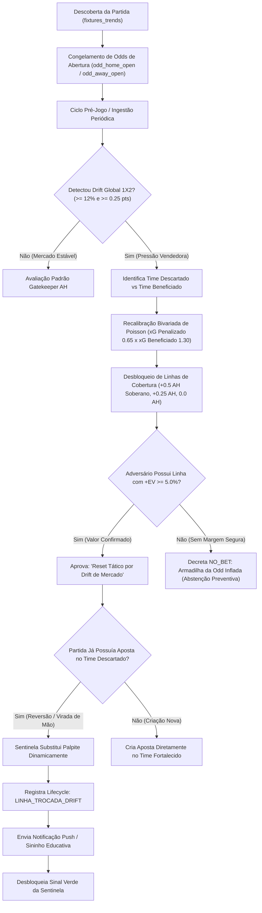

# Monitoramento Global de Drift de Mercado e a Arquitetura de Reversão Tática (+EV Institucional)

Este documento estabelece as diretrizes arquiteturais, matemáticas e operacionais do **Monitor de Drift de Mercado e Reversão Tática (Reset Tático por Drift)** na plataforma FootballWeb.

---

## 1. Visão Geral e Princípio de Negócio

No mercado de apostas esportivas profissionais, as movimentações de cotações nas bolsas e casas de topo mundial (Pinnacle, Betano, Betfair) não ocorrem por acaso. Grandes oscilações de preço (*Steam Moves* e *Drifts*) refletem o fluxo maciço de capital institucional (*Smart Money*), desencadeado por:
1. **Vazamento antecipado de informações fáticas** (rodízio de elenco, lesões em treinos fechados, poupança de titulares);
2. **Correção de precificação por sindicatos de apostas quantitativas**;
3. **Descarte estrutural de uma equipe** cujos fundamentos foram rebaixados no pré-jogo.

Historicamente, o sistema tratava o drift de forma estritamente defensiva: ao constatar a subida de odd de uma seleção apoiada, decretava abstenção (`NO_BET` por *Armadilha da Odd Inflada*).

### A Dualidade Fundamental do Drift
O mercado de apostas opera sob soma zero no balanceamento de probabilidades. Quando o mercado institucional **descarta pesadamente uma equipe** (provocando elevação de sua odd em $\ge 12\%$ e $\ge 0.25$ pontos), ocorre compulsoriamente uma **injeção massiva de suporte e encurtamento de cotação na equipe adversária**.

Portanto, o drift possui uma **natureza dual**:
* **Dimensão Defensiva**: Sinaliza que a equipe apoiada perdeu o valor pré-jogo e não deve ser mantida (*Armadilha da Odd Inflada*);
* **Dimensão Ofensiva**: Revela uma **assimetria com subsídio de mercado** a favor da equipe adversária, viabilizando a **Reversão Tática de Linha AH (Virada de Mão / Revert)**.

```text
       ┌──────────────────────────────────────────────────────────────┐
       │                 MOVIMENTAÇÃO INSTITUCIONAL                   │
       └──────────────────────────────┬───────────────────────────────┘
                                      │
              ┌───────────────────────┴───────────────────────┐
              ▼                                               ▼
   [ Pressão Vendedora ]                           [ Fluxo Comprador ]
   Favorito Original Infla                        Adversário Derrete
  (Odd sobe >= 12% / 0.25 pts)                (Odd cai >= 15% / 0.25 pts)
              │                                               │
              ▼                                               ▼
   [ Veto / Abstenção ]                           [ Oportunidade +EV ]
  Armadilha da Odd Inflada                     Reset Tático por Drift
     (NO_BET na Seleção)                       (+0.5 AH Soberano / DNB)
```

---

## 2. A Analogia com o Marco Histórico da Súmula Oficial (+0.5 AH Soberano)

O conceito de reversão tática por drift é a extensão natural da política consolidada no **Merge Request #107 (Commit `e55c7bcc1d680ab63679396b5694536b2967bbca`)**:

| Aspecto | Reset Tático por Súmula Oficial | Reset Tático por Drift de Mercado |
| :--- | :--- | :--- |
| **Gatilho de Decisão** | Divulgação oficial das escalações (T-45m a T-30m) revelando sinistro estrutural (desfalques). | Movimentação global das cotações 1X2 desde a abertura ou no pré-jogo imediato ($\ge 12\%$ e $\ge 0.25\text{ pts}$). |
| **Natureza da Evidência** | Evidência física e fática de campo (nomes ausentes na súmula). | Evidência de consenso de mercado e fluxo de capital inteligente (*Smart Money*). |
| **Ajuste Poisson** | Penaliza o desfalcado ($xG \times 0.60$) e bonifica o íntegro ($xG \times 1.35$). | Penaliza o descartado ($xG \times 0.65$) e bonifica o apoiado ($xG \times 1.30$). |
| **Linha Preferencial** | **$+0.5\text{ AH}$ Soberano** (Dupla Chance / Vitória ou Empate) se $+EV$; fallback para $0.0\text{ AH}$. | **$+0.5\text{ AH}$ Soberano** se $+EV$; fallback para $0.0\text{ AH}$ ou $-0.25\text{ AH}$. |
| **Categoria Formal** | `Reset Tático por Súmula` | `Reset Tático por Drift de Mercado` |

---

## 3. Arquitetura em 4 Camadas do Monitor de Drift

### Camada 1: Congelamento Perpétuo da Abertura Global (`fixtures_trends`)
* **Colunas Dedicadas**: `odd_home_open`, `odd_draw_open`, `odd_away_open`.
* **Regra de Ingestão (`scripts/football_ingest_trends.py`)**:
  * Ao descobrir a partida pela primeira vez, as odds 1X2 são persistidas tanto nas colunas correntes quanto nas de abertura;
  * Em ciclos subsequentes de ingestão, as colunas de abertura utilizam `COALESCE(odd_home_open, %s)`, garantindo **imutabilidade perpétua da cotação de referência de abertura**.

### Camada 2: Motor de Decisão e Recalibração de Poisson (`asian_handicap_engine.py`)
1. **Detecção Global de Abertura**:
   * O motor compara `(odd_home - odd_home_open)` e `(odd_away - odd_away_open)`.
   * Se houver variação $\ge 12\%$ e $\ge 0.25\text{ pts}$ contra uma equipe combinada com encurtamento do adversário, o contexto de drift é sintetizado compulsoriamente:
     `desfalques_criticos = {'time_desfalcado': time_inflado, 'motivos': [...], 'tipo': 'DRIFT_MERCADO'}`.
2. **Dualidade no Drift de Apostas Registradas**:
   * Se uma aposta já existente no banco de dados sofrer elevação de cotação rompendo a odd justa calculada pelo modelo:
     * O sistema **não aborta de imediato com NO_BET**;
     * Ele recalibra a matriz de Poisson e submete todas as linhas ativas da equipe oposta (beneficiada) ao Gatekeeper;
     * Se houver linha aprovada com $+EV \ge 5.0\%$, a aposta é revertida com a categoria `'Reset Tático por Drift de Mercado'`;
     * Se nenhuma linha da equipe fortalecida atingir os critérios de segurança, decreta-se abstenção (`Armadilha da Odd Inflada`).

### Camada 3: Sentinela Pré-Jogo em Tempo Real (`gemini_sentinel.py`)
* **Auditoria Contínua (T-45m a T-5m)**:
  * A função `auditar_e_recalibrar_linha_handicap` executa varredura de odds ao vivo na Betano e monitora os Cenários A (Inversão DNB), B (Drift AH) e F (Drift Global 1X2).
* **Troca Dinâmica com Preservação de Bilhete**:
  * Em **apostas pendentes**: atualiza o card e a aposta via `sync_fixture_and_bet_handicap`;
  * Em **apostas já confirmadas com dinheiro real**: atualiza atomicamente o palpite e a cotação mantendo o bilhete ativo (`confirmada = 1`) e preservando os saldos da carteira;
  * Registra o evento de auditoria no ciclo de vida (`LINHA_TROCADA_DRIFT`);
  * Dispara notificação push prioritária e alerta no Sininho do usuário com motivação clara;
  * **Liberação de Sinal Verde**: Como a seleção foi revertida para o lado com valor matemático, a trava `bloquear_sinal_verde` é desativada, permitindo que a IA Sentinela confirme a nova entrada com segurança.

### Camada 4: Interface do Usuário e Governança Visual (`index.php`)
* **UX Didática e Higienizada**:
  * O badge do Gatekeeper exibe com clareza: `<i class="bi bi-shield-check"></i> Reset Tático por Drift de Mercado`.
  * Textos didáticos traduzem o fluxo sem fórmulas brutas: *"Reversão tática orientada pelo fluxo institucional de mercado: o favorito inicial sofreu forte pressão vendedora e o adversário recebeu suporte massivo, abrindo oportunidade de valor (+EV) na linha oposta."*
* **Trava de Governança de Súmula (`unlockBetConfirmButton`)**:
  * Ao ajustar ou revalidar uma linha, se a aposta pertencer à categoria Quase Premium / Premium cuja escalação oficial ainda não foi publicada, o botão de confirmação permanece cinza e desabilitado (`btn-secondary disabled` com ícone de ampulheta e texto `⏳ Aguardar Súmula`), impedindo confirmações prematuras sem o aval da Sentinela.

---

## 4. Fluxograma Arquitetural Completo



---

## 5. Parâmetros e Critérios Objetivos de Gatilho

| Parâmetro | Limiar Canônico | Justificativa Matemática e de Mercado |
| :--- | :--- | :--- |
| **Variação Mínima Percentual ($\Delta\%$ 1X2)** | $\ge +12.0\%$ | Oscilações abaixo de 10% representam ruído natural de bookmaker. Acima de 12%, há fuga institucional de capital. |
| **Variação Mínima Nominal ($\Delta$ pts 1X2)** | $\ge +0.25\text{ pts}$ | Evita falsos-positivos em odds super-esmagadas (ex: 1.15 para 1.25 representa 8%, mas sem peso estatístico). |
| **Encurtamento do Oponente ($\Delta\%$ Queda)** | $\ge 15.0\%$ ou $\ge 0.25\text{ pts}$ | Comprova a migração ativa de liquidez para o adversário (*Steam Move*). |
| **Margem Justa de Salvaguarda** | $\le Odd_{Justa} \times 1.10$ | Se a cotação subiu apenas convergindo para o valor justo calculado pelo modelo, representa ganho de valor (+EV), nunca armadilha. |
| **Piso de Rentabilidade Operacional** | $Odd \ge 1.45$ (Ideal $\ge 1.60$) | Impede a entrada em odds derretidas sem retorno matemático sobre a banca. |
| **Piso de Probabilidade Efetiva** | $P_{eff} \ge 50.0\%$ | Garante viabilidade de cobertura matemática no modelo de Poisson recalibrado. |

---

## 6. Salvaguardas e Regras de Ouro Invioláveis

1. **Zero Dados Sintéticos (Regra 12)**:
   - Toda e qualquer linha sugerida pelo Reset Tático por Drift deve obrigatoriamente existir com cotação real, ativa e líquida na API oficial da Betano (Bookmaker ID 32) ou Pinnacle. É terminantemente proibido inventar linhas sintéticas a partir do 1X2.
2. **Preservação Estrutural do Histórico U5J (Regra 16)**:
   - Toda gravação e atualização em `fixtures_trends.ah_reasoning` e `apostas.resultado_detalhado` deve obrigatoriamente utilizar `compose_compound_ah_reasoning`, preservando o payload `|| U5J_DATA:` íntegro.
3. **Higienização Visual Estrita (Regra 17)**:
   - A interface do usuário (cards e modais) exibe estritamente a síntese em linguagem natural (campo `REASON:`). É proibido o vazamento de marcadores como `|| MEMÓRIA DE CÁLCULO`, lambdas de Poisson ou dicionários serializados na tela.
4. **Proteção da Banca contra Estados Corrompidos (Regra 15)**:
   - Se os dados de cotações em tempo real da casa estiverem inacessíveis e não houver histórico gravado, o sistema decreta abstenção e nunca emite apostas sobre premissas estatísticas ausentes.
